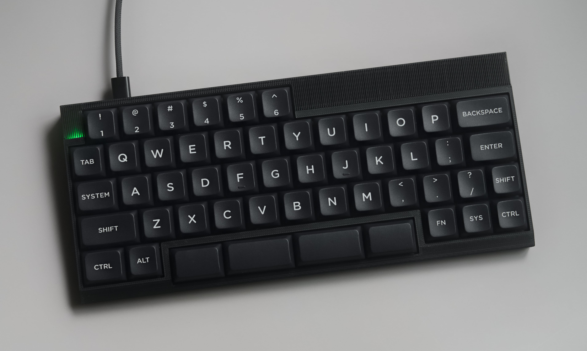

# Transporter

Transporter is a low-profile V4N4G0N type keyboard with exploded bars, built around the $0.5 WCH CH32X035 MCU.

## Files

- [`transporter-pcb/`](transporter-pcb/): KiCad project
    - [Interactive BOM](transporter-pcb/bom/ibom.html)
    - [JLCPCB production files](transporter-pcb/jlcpcb/production_files/)
    - [View the PCB on KiCanvas](https://kicanvas.org/?github=https%3A%2F%2Fgithub.com%2Fcarrefinho%2Ftransporter%2Ftree%2Fmain%2Ftransporter-pcb)
- [`case/facade/`](case/facade/): Facade v4 case files

## Firmware

Find the ZMK module at [transporter-zmk-module](https://github.com/carrefinho/transporter-zmk-module)

## License

[CERN-OHL-P v2](LICENSE)
